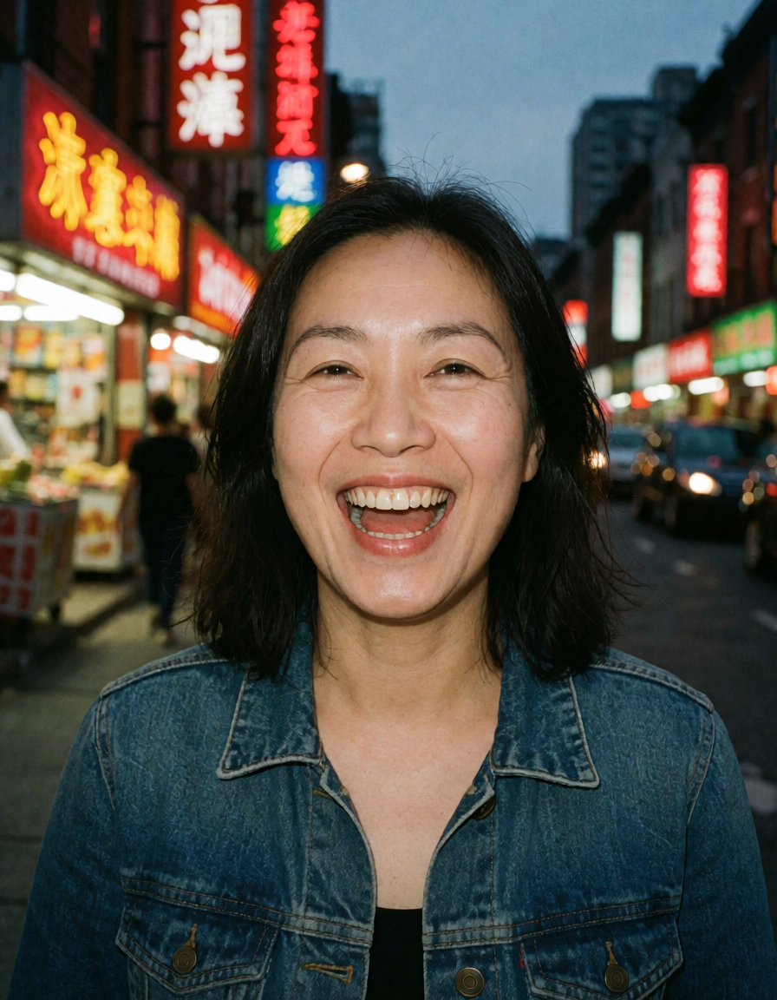
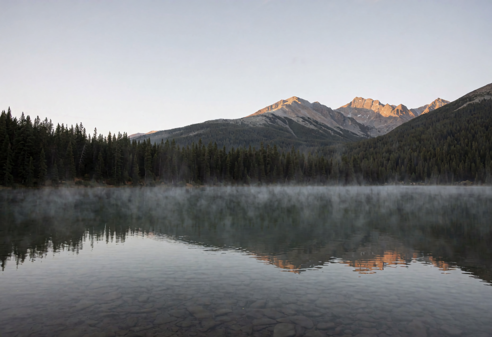

# Krea 2 Turbo on Apple Silicon (ComfyUI / MPS) (16GB+ RAM, M1+)

Run [Krea 2](https://huggingface.co/Comfy-Org/Krea-2) — the open-weights 12B DiT from Krea AI —
**fully locally on a Mac**. This repo is the working recipe plus every MPS-specific failure
mode we hit getting there, so you don't burn the hours we did.

Tested on an M5 Pro 48 GB (bf16) and an M1 MacBook Air 16 GB (Q4 GGUF, see [16 GB Macs](#16-gb-macs-gguf)).

Krea 2 is commercially licensed, which makes it one of the few open t2i models whose output
you can ship to clients.

## Examples

All rendered locally on an M-series Mac with the exact workflow in this repo — bf16, **8 steps** (the shipped default), no upscaler, no post. Same seed per pair; left has the Realism Engine node bypassed (the shipped default), right has it enabled at 0.4.

| Realism Engine off (default) | Realism Engine 0.4 |
|---|---|
|  |  |
|  |  |
|  |  |
|  |  |

## The files

`Krea2-Turbo_Mac_16GB.json` is the small-Mac version: see [16 GB Macs](#16-gb-macs-gguf).

The main workflow is `Krea2-Turbo_Mac.json`. The core Turbo recipe (UNet → TE → 8-step sampler),
plus a Realism Engine LoRA node that **ships bypassed** so the base graph runs on just the three
required models — nothing else to download before your first render. Turn the LoRA on for cleaner
skin: select the purple node and press **Ctrl+B** (or right-click → Set Mode → Always); the same
keys toggle it back off. (Never set its strength to 0 — see gotcha 2.)

It ships with two in-graph info panels: a **model download panel** (direct HF links with sizes
and install paths) and a **recipe/gotchas panel** — so you don't need this README open while
you work. 100% ComfyUI core nodes, no custom nodes.

## Requirements

- Apple Silicon Mac. **bf16 wants ~48 GB** unified memory: the three models total ~35.5 GB, but
  they don't all sit resident at once (ComfyUI loads the TE, encodes, unloads it, *then* loads the
  UNet), so **peak is ~26 GB + working set**. 36 GB runs but swaps hard; ≤32 GB isn't realistic on
  bf16. **On less RAM, use the fp8 path** (below) — it drops the UNet to ~13 GB and brings 24-32 GB
  Macs into range. **On 16 GB, use the GGUF workflow** (see [16 GB Macs](#16-gb-macs-gguf)).
- ComfyUI (recent build — needs the `krea2` CLIP type)
- Models from [Comfy-Org/Krea-2](https://huggingface.co/Comfy-Org/Krea-2):
  - `diffusion_models/krea2_turbo_bf16.safetensors`
  - `text_encoders/qwen3vl_4b_bf16.safetensors`
  - `vae/qwen_image_vae.safetensors`

**bf16 is the zero-dependency default — but fp8 now runs too.** MPS couldn't touch fp8 for a
long time (the `Float8_e4m3fn` wall), which is why bf16 used to be the only option. That changed:
the community node **[ComfyUI-AppleSilicon-FP8](https://github.com/pawel-mazurkiewicz/ComfyUI-AppleSilicon-FP8)**
(by pawel-mazurkiewicz) patches PyTorch's MPS backend at startup with a lookup-table fp8→float
decode, and with it the fp8 checkpoint renders cleanly on Apple Silicon.

| Checkpoint | Size | On Mac |
|---|---|---|
| `krea2_turbo_bf16` | 26.3 GB | ✅ default — zero extra deps, 100% core nodes |
| `krea2_turbo_fp8_scaled` | 13.1 GB | ✅ works with torch 2.11 + the AppleSilicon-FP8 node (see below) |
| `krea2_turbo_int8_convrot` | 13.5 GB | ❌ `int8_tensorwise` unsupported; ConvRot kernels are CUDA-only |
| `krea2_turbo_mxfp8` / `nvfp4` | 13.5 / 7.7 GB | ❌ NVIDIA Blackwell formats |
| GGUF quants ([vantagewithai](https://huggingface.co/vantagewithai/Krea-2-Turbo-GGUF)) | 4.9-13.7 GB | ✅ with current ComfyUI-GGUF; Q4_K_M (7.5 GB) tested on a 16 GB M1 |

### Running fp8 (lower RAM: ~13 GB UNet)

Reach for this if bf16's ~26 GB is too much for your Mac:

1. **torch 2.11+** — the MPS fp8 support landed here.
2. Install **[ComfyUI-AppleSilicon-FP8](https://github.com/pawel-mazurkiewicz/ComfyUI-AppleSilicon-FP8)** (ComfyUI Manager → search "AppleSilicon-FP8", or clone into `custom_nodes/` and `pip install -r requirements.txt`), then restart ComfyUI.
3. Download `diffusion_models/krea2_turbo_fp8_scaled.safetensors` and point the UNETLoader at it. Nothing else in the workflow changes.

It's a **memory win, not a speed win**: the default path decodes fp8→bf16 before the matmul, so
render time is about the same as bf16 — you just fit in ~13 GB of UNet instead of ~26, which is
what brings 24-32 GB Macs into range. Output looks the same as bf16. Credit to pawel-mazurkiewicz;
the node is the whole reason this works. Note this path adds that one custom node, so the fp8 route
isn't strictly "core nodes only" — the bf16 default still is.

## 16 GB Macs (GGUF)

`Krea2-Turbo_Mac_16GB.json` runs Krea 2 Turbo on an M1 MacBook Air 16 GB. Same recipe, smaller
files, one custom node:

- `diffusion_models/krea2_turbo-Q4_K_M.gguf` (7.5 GB) from [vantagewithai/Krea-2-Turbo-GGUF](https://huggingface.co/vantagewithai/Krea-2-Turbo-GGUF)
- `text_encoders/qwen3vl_4b_fp8_scaled.safetensors` (5.0 GB) from [Comfy-Org/Qwen3-VL](https://huggingface.co/Comfy-Org/Qwen3-VL/tree/main/text_encoders)
- `vae/qwen_image_vae.safetensors` (254 MB), the same VAE as above
- Custom node: [ComfyUI-GGUF](https://github.com/city96/ComfyUI-GGUF) (city96), for the Unet Loader (GGUF). The fp8 text encoder loads in core ComfyUI, no fp8 node needed.

The four examples above, re-rendered on the M1 with the same prompt and seed (8 steps, nothing
else running):

| Example | Time | Peak memory (whole system) | Max swap |
|---|---|---|---|
| cafe 832x1216 | 22m52s | 14.6 GB | 3.9 GB |
| carpenter 1024x1024 | 25m42s | 14.7 GB | 4.0 GB |
| street 896x1152 | 23m37s | 14.6 GB | 3.6 GB |
| lake 1216x832 | 27m38s | 14.5 GB | 4.7 GB |
| (768x768, 21 Oct) | 12m16s | 14.4 GB | 3.3 GB |

| M5 Pro 48 GB, bf16 | M1 16 GB, Q4_K_M |
|---|---|
|  |  |
|  |  |
|  |  |
|  |  |

Same scene and subject every time; Q4 moves smaller details around (a hand, a cup, the peaks).
It swaps a few GB on 16 GB but never ran out of memory. Close browsers and other heavy apps first.
The Realism Engine LoRA is left out of the 16 GB workflow: not tested with GGUF on 16 GB yet.
More RAM? Q5_K_M (8.9 GB) or Q6_K (10.6 GB) from the same repo use the same loader (not tested here).

## The locked recipe

| Setting | Value |
|---|---|
| UNet | `UNETLoader` → `krea2_turbo_bf16.safetensors`, dtype `default` |
| Text encoder | `CLIPLoader` → `qwen3vl_4b_bf16.safetensors`, **type = `krea2`** |
| VAE | `qwen_image_vae.safetensors` (a Flux VAE decodes to scrambled noise) |
| Sampler | **8 steps · cfg 1.0 · euler · simple · denoise 1.0** (Krea's official distilled schedule) |
| Negative | `ConditioningZeroOut` of the positive — at cfg 1 negatives are dead, don't write them |
| Latent | 1024×1024, 896×1152, 832×1216, or 1216×832 |

**Steps — a detail dial, not a quality requirement.** 8 steps is Turbo's design point and the
workflow default; it holds up even well past the training resolution. Steps above 8 resolve
extra micro-texture (skin pores, fabric weave) at proportional render time — **12–26 can be
worth it on the hardest close-up portraits**, and barely matters elsewhere. Same seed keeps
the composition across step changes, so hunt at 8 and re-render a keeper higher only if it
needs it. (The example images are straight 8-step renders.)

**Trap — do NOT set the timestep shift manually.** Krea's model card lists `Timestep Shift
(μ): 1.15`, but ComfyUI already applies it inside the `krea2` loader. Adding a
`ModelSamplingSD3` node "per the card" double-shifts the schedule and renders pure colorful
static — at any resolution.

At cfg 1 the positive prompt is the *only* steering, so how you phrase it matters more than on
a CFG model:

- **Lead with a photographic framing**, e.g. `sharp high-detail realistic photograph, natural
  skin texture with fine pores, crisp focus, of …` or, for night/flash scenes, `realistic
  candid iphone flash photo at night, natural detailed skin, of …`. Do **not** use `amateur
  smartphone photo, unedited` — that tag actively *softens* and lowers fidelity (it's what
  made early tests look low-quality).
- Then short comma-phrases: `[pose/action], [expression], [clothing], [setting], [lighting]`.
  State the expression explicitly or you get a neutral house-face.
- **Pin ethnicity/age** — anything you leave unstated drifts when you change steps, seed, or
  LoRA strength. `clear complexion, few freckles` cleans up freckle-heavy skin.

## MPS gotchas (the reason this repo exists)

These are Apple-Silicon backend bugs, not Krea 2 bugs — most will bite you on any large
DiT in ComfyUI on a Mac.

1. **`batch_size` must be 1** — but queue as many jobs as you like. These are different
   things: the `batch_size` widget (the batch dimension inside one render) is what breaks on
   MPS — set it to 4 and only *one* of the four denoises; the rest come out as pure static
   (tested: a batch of 4 gave three noise frames and one clean image). Large batches at full
   res also spike past 48 GB and OOM ComfyUI. Submitting many *separate* prompts to the queue,
   each at batch_size 1, is totally fine — that's how you render a sweep. Loop seeds, don't batch.
2. **Never set a LoRA to strength 0.0 — bypass the node instead.** A `LoraLoaderModelOnly` at
   0.0 NaNs the model on MPS and renders pure black. A zeroed patch is *not* a no-op here. To
   turn a LoRA off, right-click → Bypass (or Ctrl+B), which excludes it from the graph cleanly.
3. **First render is slow, then fine.** Cold-loading ~26 GB takes minutes; keep ComfyUI
   warm between renders. Run *without* `--disable-smart-memory` so the model stays resident
   across a seed hunt — but if the same instance must also load another large model, batch
   all Krea 2 work first; two big models co-resident will OOM.
4. **Cheap black/noise detection:** render a 512px probe and check mean luminance
   (PIL `ImageStat`) — mean < 8 = black output (gotcha 2), > 150 = noise (gotcha 1).
   Beats eyeballing full-res renders one by one.

## Optional add-on: Realism Engine LoRA

[Realism Engine for Krea 2](https://civitai.com/models/3109006) is a skin/texture LoRA that
takes the edge off Turbo's distillation look. Load it with **`LoraLoaderModelOnly`** — the
full `LoraLoader` also patches the text encoder, which re-interprets your prompt and shifts
the whole image. The node ships **bypassed** at strength **0.4** — the sweet spot for clean skin
without over-smoothing. Enable it with **Ctrl+B** (or right-click → Set Mode → Always) once the
LoRA file is in place; the same keys switch it back off. Never zero the strength (see gotcha 2).

**Identity drift warning:** at cfg 1 nothing anchors attributes you don't specify, and a LoRA
pulls every unspecified attribute toward its own training data. We watched a subject's
ethnicity flip between renders just from changing RE strength (0.8) or step count — same seed.
The fix isn't a magic strength value, it's the prompt: **state ethnicity/age explicitly** and
they hold across settings. Keep RE around 0.4; it cleans skin but doesn't fix freckles on its
own — add `clear complexion, few freckles` for that.

The same slot takes any Krea 2 model-only LoRA, including your own character LoRAs trained
on the undistilled Raw checkpoint (rank 32 / alpha 16 is a good starting point; disable
horizontal flip for asymmetric faces).

## Raw (undistilled)

`krea2_raw_bf16.safetensors` needs cfg ~4 and 25–30 steps. Use it as a LoRA-training base or
when the Turbo distillation look itself is the problem — for everything else Turbo is the
workhorse.
